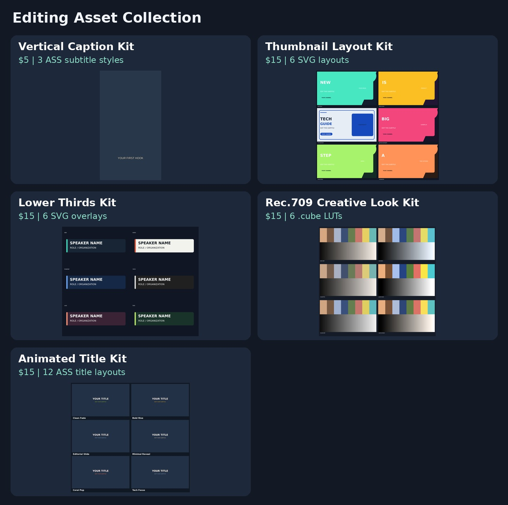

# Video editing sample

Short-form vertical editing sample by David Jamburia.

- Format: 720x1280 vertical
- Duration: 10 seconds
- Editing sample only

## Products

- [Vertical Caption Kit v1](products/vertical-caption-kit/) — three subtitle styles, US$5.
- [Thumbnail Layout Kit v1](products/thumbnail-layout-kit/) — six editable SVG thumbnail layouts, US$15.
- [Lower Thirds Kit v1](products/lower-thirds-kit/) — six transparent name/title overlays, US$15.
- [Rec.709 Creative Look Kit v1](products/rec709-look-kit/) — six .cube color looks, US$15.
- [Animated Title Kit v1](products/animated-title-kit/) — six animated title styles in two aspect ratios, US$15.

| Kit | File format | Quantity | Price |
| --- | --- | ---: | ---: |
| Caption | ASS | 3 styles | $5 |
| Thumbnail | SVG | 6 layouts | $15 |
| Lower thirds | SVG | 6 static overlays | $15 |
| Color looks | CUBE | 6 creative LUTs | $15 |
| Animated titles | ASS | 12 layouts (6 styles) | $15 |

### Order and compatibility

Choose a kit and check its product page for preview, compatibility, license and exclusions. All five together cost $65 at the listed individual prices, before any applicable fees. Email [an order inquiry](mailto:jamburiawork@gmail.com?subject=Editing%20kit%20order&body=Kit%20name%3A%0AEditing%20software%3A%0AQuestions%3A) with the kit name and your editing software. The seller confirms the order, delivery and refund terms, and the authorized payment arrangement before issuing a valid PayPal payment request. The designated PayPal address appears on each product page. ZIP delivery follows confirmation of completed payment. No account or automated checkout is provided by this repository.

The preview images are illustrative, not customer work. The full downloadable packages are delivered privately after a confirmed order; preview pages alone do not include the paid asset files. Commercial-use terms apply to finished video projects, not resale of the standalone templates.
