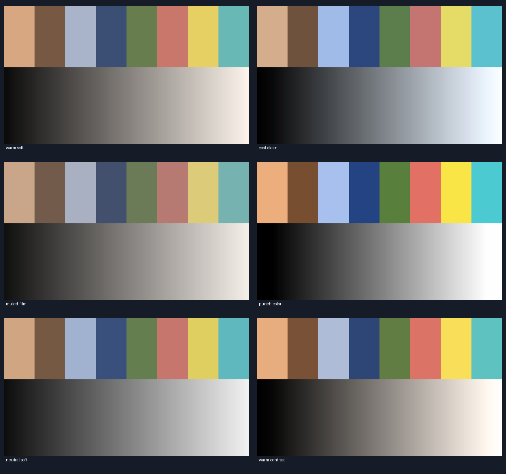

# Rec.709 Creative Look Kit v1

**Price: US$15.** Six editable 17-point `.cube` color looks for normalized display-referred Rec.709 video.

Warm Soft, Cool Clean, Muted Film, Punch Color, Neutral Soft and Warm Contrast. Includes a usage guide and license for personal and commercial finished video projects; standalone LUT redistribution and resale excluded. These are creative looks, not camera-specific log conversions. Use a LUT-compatible editor, correct exposure first and check the result on actual footage. All six rendered successfully with FFmpeg. The preview is a synthetic chart, not graded real footage.

## Ordering

1. Email [jamburiawork@gmail.com](mailto:jamburiawork@gmail.com?subject=Rec709%20Creative%20Look%20Kit%20order) with the product name.
2. Confirm order, delivery, license and refund terms. Designated payment method: PayPal (Jamburiainc@gmail.com), subject to an authorized and eligible receiving arrangement. Pay only against a confirmed order and valid payment request.
3. Receive the ZIP by email after completed payment is confirmed.

Manual ordering, not an automated checkout.
